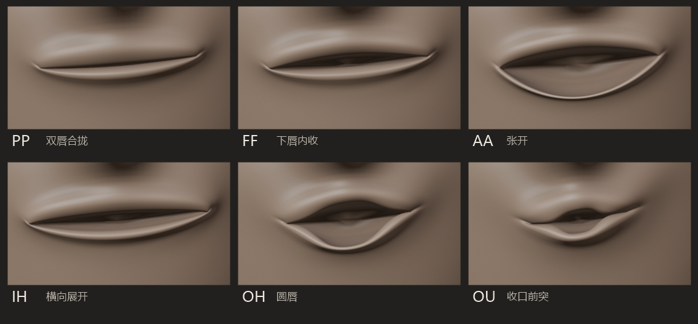
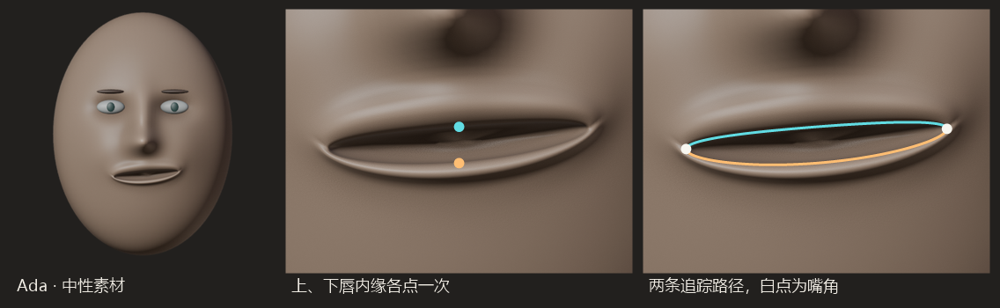
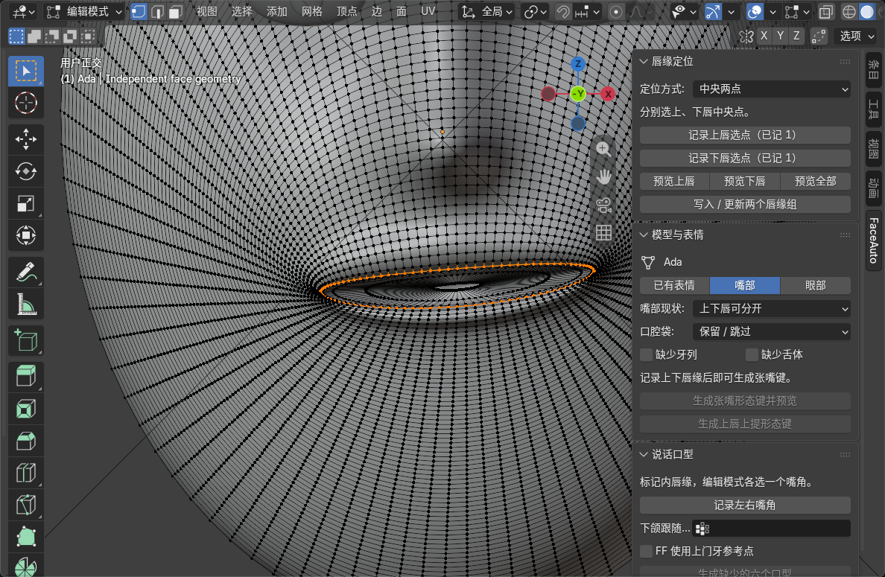
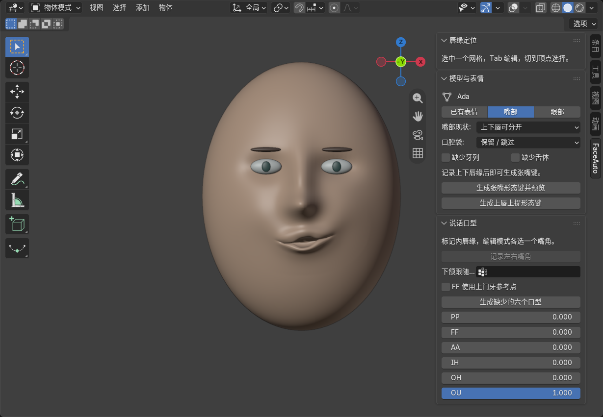
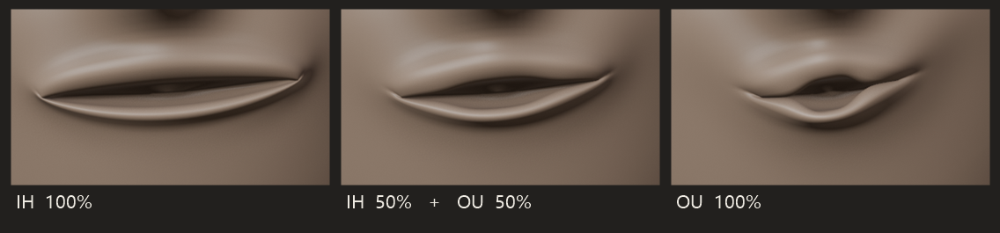
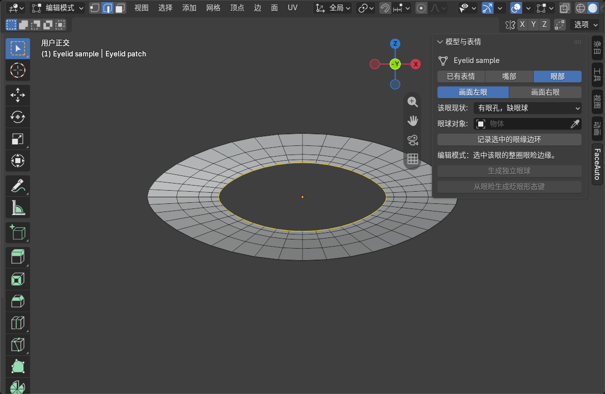

# FaceAuto

FaceAuto 是一个 Blender 扩展，用来给角色制作说话口型和眨眼形态键。在嘴上，你点出上下唇的位置，插件沿网格追出两条唇缘；再选两个嘴角，就能生成闭唇、咬唇、张口、展唇和圆唇等六个姿势。在眼睛上，你选出一圈眼缘，插件从中找到两个眼角，分出上下眼睑，生成这一侧的眨眼键。每个姿势都可以在 Blender 中继续雕刻。



## 安装与练习模型

1. 在 Blender 中打开 **编辑 → 偏好设置 → 获取扩展**，从右上角菜单选择 **从磁盘安装**，选中 `vrc_faceauto-0.7.0.zip` 并启用扩展。扩展清单要求 Blender 4.2 或更高版本，本文演示使用 5.2.3 LTS。
2. 打开仓库中的 [new_face.blend](blenderModel/new_face.blend)，选中头部对象 **Ada**。这张测试脸有 9,504 个顶点，初始形态键、动画动作和预标记顶点组均为零。
3. 鼠标放在 3D 视图，按 **N → FaceAuto → 模型与表情**。选「嘴部」开始做口型，选「眼部」制作眨眼。「已有表情」可直接预览模型自带的键。

换用自己的角色时，先检查**头部网格的局部轴**。插件沿 X 寻找左右嘴角和眼角，沿 Z 区分上下唇与上下睑，朝 −Y 推出嘴唇。

## 给 Ada 做第一组口型

### 从两个点追出上下唇缘

在「模型与表情」选 **嘴部 → 上下唇可分开**。按 Tab 进入编辑模式，按主键盘 1 切到顶点选择。在「唇缘定位」选择 **中央两点**，单独选中上唇内缘中央的一个顶点，点「记录上唇选点」。再单独选中下唇内缘中央的一个顶点，点「记录下唇选点」。选点要落在围住嘴口的内圈边上。



点 **预览全部**。插件从每个种子沿四边形边流向两侧追踪。下图中，上下唇按钮各显示「已记 1」，橙色高亮则是插件找出的整圈内缘。检查它是否沿着嘴口走到两个嘴角，再点 **写入 / 更新两个唇缘组**。Ada 的 `Scan_upper_lip` 和 `Scan_lower_lip` 各有 49 个顶点。



三角面或不规则边流适合用 **端点及引导点**。分别在上下内唇缘选出左右端点，在转弯处加引导点，预览路径；若某段绕到脸颊，就在那一段的正确边线上补点。已有上述两个唇缘组的模型可以直接标记嘴角。

### 用嘴角确定嘴宽，生成六个口型

1. 在编辑模式清空选择，同时选中左右嘴角各一个顶点，在「说话口型」点 **记录左右嘴角**。两点之间的横向距离决定这张脸的中性嘴宽。
2. 有上门牙时，可以把 3D 游标吸附到上门牙中央下缘，勾选「FF 使用上门牙参考点」并记录游标。生成 FF 时，下唇中央会向牙齿切缘靠近。Ada 使用默认的下唇内收姿势。
3. 按 Tab 回到物体模式，点 **生成缺少的六个口型**。每次把一个滑块从 0 拖到 1，观察从中性脸到完整姿势的变化。

| 形态键 | 预览时看哪里 |
|---|---|
| `vrc.v_pp` | 双唇在中间合拢，适合 P、B、M 的起音。检查唇缘接触处。 |
| `vrc.v_ff` | 上唇轻抬、下唇内收。有门牙的角色从侧面检查唇齿间距。 |
| `vrc.v_aa` | 下唇下移，形成较大的开口。检查下唇中央到嘴角的弧线。 |
| `vrc.v_ih` | 嘴角向两侧展开，中央留一条较窄的开口。 |
| `vrc.v_oh` | 嘴角收拢，中央形成圆口，嘴唇向前突出。 |
| `vrc.v_ou` | 开口比 OH 更窄，前突更明显。从侧面比较这两个键。 |



在 **网格数据属性 → 形态键** 中选中要精修的键，进入编辑模式即可移动顶点。插件保留同名键，因此可以先雕好一个姿势，再补齐其余口型。要按新唇缘重算某个姿势，先另存雕刻版本，再删除对应键并重新生成。



## 给单只眼睛制作眨眼

在 **模型与表情 → 眼部** 选「画面左眼」或「画面右眼」。画面左眼对应头部局部 X 的负侧。两只眼分别记录，可以单独眨动。

| 模型上的眼睛 | 在编辑模式选什么 | 接下来做什么 |
|---|---|---|
| 已有独立眼球 | 在头部选一整圈眼睑边缘 | 指定现有眼球，点「记录选中的眼缘边环」 |
| 有眼孔，缺眼球 | 选眼孔内缘的一整圈边 | 记录边环，在物体模式点「生成独立眼球」 |
| 眼睛画在贴图上 | 选一只眼的眼白和虹膜所占的面 | 点「记录眼缘并隐藏选中眼面」。插件提取选区外轮廓，用修改器隐藏原眼面，可在原处生成眼球 |



截图中黄色的内圈是需要选的眼缘，外围几圈是跟随眼睑运动的皮肤。回到物体模式，点 **从眼睑生成眨眼形态键**。将「眨眼」从 0 拖到 1，检查上下睑的相接位置。需要弧形闭眼线时，在该侧眨眼键上调整中央几个顶点。生成的独立眼球可以在面板中调水平转角和俯仰角。[眼缘与眼球实现](vrc_faceauto/eyes.py)

保留原始四材质分区的完整 ICT-FaceKit 脸（26,719 个顶点）还可以使用「眼珠视线 · ICT」。插件以最小二乘法拟合双眼球心，绕各自球心旋转眼区顶点，生成左、右、上、下四个视线键。水平角度为 ±20°，俯仰角度为 ±12°。[ICT 视线实现](vrc_faceauto/gaze.py)

## 按模型结构补嘴缝、口腔和张嘴控制

**上下唇黏在一起。** 在无形态键、网格数据为单用户的副本上标记上下唇缘，选择「嘴缝黏合」，点「检测并高亮跨缝面带」。核对高亮面确实位于两条唇缘之间，再点「沿面带中央切开」。插件将新切口的两侧记为 `FaceAuto_SeamUpper` 和 `FaceAuto_SeamLower`，后续变形优先使用这两条真实切边。预览后若编辑了网格，重新检测即可。[嘴缝检测与切开](vrc_faceauto/seam.py)

**张嘴后需要露出口腔。** 有开放切边时，「从开放切边补建相连口腔袋」会平滑唇缘、向内生成有厚度的唇壁，再接上封底的口腔袋。想用独立物体布置口内结构，可以分别选择「补独立口腔袋」「仅补牙列」或「仅补舌体」。同一头部网格里的下牙和口内软组织可以加入「下颌跟随组」，用权重调节说话时的跟随量。独立牙齿物体使用角色自身的骨骼或父子关系驱动。[唇壁与口腔袋](vrc_faceauto/lining.py) · [独立口内组件](vrc_faceauto/oral.py)

**需要单独控制张嘴幅度。** 「生成张嘴形态键并预览」建立整体张嘴键 `Open_All`。「生成上唇上提形态键」建立 `FaceAuto_UpperLipUp`。两者在唇中央的位移最大，向嘴角按正弦平方衰减，影响半径分别为中性嘴宽的 40% 和 24%。[上下唇控制实现](vrc_faceauto/opening.py)

**已有一至三个张嘴控制键。** 打开「嘴部开度」，输入左、中、右的目标开度，例如 40%、46%、40%。选择控制数并点「计算权重并应用」，面板会给出三个位置的实测开度和最大误差。整体键适合上下联动，三区独立键可分别拟合左右开度。支持的 ICT 控制布局还可以用「生成精简 ICT 副本」将多个键合并为一个整体键，或一对双侧、中央键。[开度面板与精简副本](vrc_faceauto/panel.py)

## 算法

### 唇缘怎样沿着网格走

在规则四边形上，程序从中央种子分别沿局部 X 正、负方向起步。在每个顶点排除来边以及与来边同面的转向边，沿唯一的延续边前进，到横向坐标开始折返时停止。多点模式把相邻引导点 $A,B$ 之间的追踪写成最短路径问题。设 $L=\|B-A\|$，$d_j$ 是顶点 $p_j$ 到直线 $AB$ 的垂距，程序在 X 递增的连通路径中求

$$
P^*=\arg\min_P\sum_{(i,j)\in P}\|p_j-p_i\|\left(1+4d_j/L\right).
$$

第一项按实际边长计费，括号内的系数提高偏离引导线的代价。补一个引导点会改变对应区段的参考直线。[唇缘追踪源码](vrc_faceauto/lip_trace.py)

### 从中性唇线计算每个口型

设左右嘴角为 $x_L,x_R$，中性嘴宽 $W=x_R-x_L$，中线 $c=(x_L+x_R)/2$。把每个唇缘顶点的横坐标换成 $t=\mathrm{clip}((x-x_L)/W,0,1)$。沿两条中性唇缘插值，得到该位置原有的上下间距 $g_0(t)$。

每个口型有四个参数：嘴宽倍率 $s$、中央开度比 $h$、前突比 $f$ 和上唇承担的张开比例 $r$。常规开口轮廓在嘴角取零，在中央达到目标开度 $hW$。

$$
a(t)=\sin^{0.85}(\pi t),\qquad G=hWa(t),\qquad e=G-g_0(t)
$$

$$
\Delta x=(s-1)(x-c),\quad \Delta y=-Wf(0.45+0.55a),\quad
\Delta z_{\mathrm{upper}}=re,\quad \Delta z_{\mathrm{lower}}=-(1-r)e .
$$

例如，中央原本张开 $0.05W$，AA 的目标为 $0.31W$，上下唇合计只需再拉开 $0.26W$。嘴角的垂直位移固定为零。PP 将两唇推向中性唇线的中间位置，允许微张嘴保留至多 $0.004W$ 的间隙。FF 可用上门牙下缘引导下唇，中央的跟随量最大。

OH 和 OU 同时收窄嘴宽和开口轮廓。令 $u=2t-1$，OH 取 $b=0.82$，OU 取 $b=0.60$。新的间距 $G$ 和横坐标 $x'$ 为

$$
G=hW\exp[-1.45(u/b)^4]\sqrt{\max(0,1-u^2)},\qquad
x'=c+s(0.76+0.24u^2)(x-c).
$$

较小的 $b$ 将 OU 的开口集中在中央。每个键单独保存相对于 Basis 的顶点坐标。[口型参数与形态键生成](vrc_faceauto/speech.py)

### 皮肤怎样跟随，眼睑怎样闭合

嘴唇上的标记点给定了位移，周围皮肤通过相连的网格边获得位移。设 $D_k$ 为最近约束点的位移，$d_i$ 为沿网格边到该点的最短距离。说话口型的影响半径为 $R=0.55W$。半径内的初值和相邻顶点权重为

$$
D_i^{(0)}=D_k(1-d_i/R)^2,\qquad w_{ij}=1/\max(\|p_i-p_j\|,10^{-10}).
$$

程序固定约束点，对其余顶点迭代 48 次。影响半径外的位移为零，拓扑上独立的牙齿可以另行驱动。[位移扩散源码](vrc_faceauto/fields.py)

$$
D_i^{(n+1)}=0.35D_i^{(n)}+0.65\frac{\sum_{j\sim i}w_{ij}D_j^{(n)}}{\sum_{j\sim i}w_{ij}} .
$$

眼部使用同一个扩散函数。程序取闭合眼缘上 X 最小和最大的点为眼角 $L,R$，沿环走出两条弧，平均 Z 较高的弧为上睑。完全闭眼时，顶点 $p_i$ 沿眼角连线找到对应的位置，上下睑在相同横坐标处闭合。[眨眼源码](vrc_faceauto/eyes.py)

$$
t_i=\mathrm{clip}((x_i-x_L)/(x_R-x_L),0,1),\qquad
\Delta p_i=(1-t_i)L+t_iR-p_i .
$$

### 从目标开度求已有控制键的权重

程序在嘴宽的 25%、50%、75% 处测量上下唇间距，按中性嘴宽换算成百分比，得到中性向量 $g^0$。依次将每个控制键单独设为 1 并测量，得到响应矩阵 $A$，其第 $j$ 列是第 $j$ 个键带来的三处开度增量。给定目标 $g^*$，求解器寻找 0 到 1 之间的一组权重，使三个位置的平方误差之和最小。

$$
w^*=\arg\min_{0\le w_j\le1}\|Aw-(g^*-g^0)\|_2^2,\qquad \hat g=g^0+Aw^* .
$$

$\hat g$ 是按线性响应预测的开度。应用权重后，插件重新测量 Blender 求值后的网格，用实测值报告误差。[测量实现](vrc_faceauto/calibration.py) · [权重求解器](vrc_faceauto/solver.py)

## 实测与 VRChat 映射

下表来自 Ada，每次只把一个口型设为 1。三列均以中性嘴宽为单位，中央前突取上下唇的平均位移，负值表示内收。

| 姿势 | 中央开度 | 当前嘴宽 | 中央前突 |
|---|---:|---:|---:|
| PP | 0.4% | 99% | +0.8% |
| FF（默认，无门牙参考） | 7.4% | 101% | −1.95% |
| AA | 31% | 101% | +0.5% |
| IH | 10.5% | 114% | −1.2% |
| OH | 28% | 78% | +7.2% |
| OU | 14.5% | 60% | +12.5% |

在清除形态键的 ICT 中性脸和已切开嘴缝的三角网角色上，项目也做过 FBX 往返测试。两份模型从 Blender 导出再导入后，均保留六个键名，每个键都包含非零顶点位移。

在 Unity 中选中角色，打开 **VRC Avatar Descriptor → Lip Sync**，选择 **Viseme Blend Shape** 并指定脸部的 **Skinned Mesh Renderer**。将上表六个键分别填入 **PP、FF、aa、ih、oh、ou** 槽位。

## 从源码构建并复现实验

在本 README 所在目录打开 PowerShell。若 Blender 未加入 PATH，将第一行的 `'blender'` 换成本机 `blender.exe` 的完整路径。

```powershell
$blender = 'blender'
$package = '.\vrc_faceauto-0.7.0.zip'
& $blender -b --command extension build --source-dir .\vrc_faceauto --output-dir .
& $blender -b --command extension validate $package
& $blender -b --command extension install-file -r user_default -e $package
```

校验并启用扩展后，在同一窗口运行 Ada 演示。脚本打开中性模型，以两个预设坐标模拟选点，调用插件预览唇缘、建组、记录嘴角并生成六个口型。[演示脚本](lab/demo_ada.py)

```powershell
& $blender -b --python-exit-code 1 -P .\lab\demo_ada.py
```

打开 `lab/output/ada_visemes.blend` 可检查生成的键。同目录的 `metrics.json` 记录上表的测量值，`markers.json` 保存唇缘和嘴角的图像坐标。Windows 上可以用下面的命令把渲染结果排成唇缘标记图、六口型图和 IH 到 OU 的过渡图。[图版脚本](lab/demo_images.ps1)

```powershell
.\lab\demo_images.ps1
```

| 仓库路径 | 内容 |
|---|---|
| [vrc_faceauto/](vrc_faceauto/) | 插件源码与 Blender 扩展清单 |
| [blenderModel/new_face.blend](blenderModel/new_face.blend) | 用于练习和复现实验的中性 Ada |
| [docs/images/](docs/images/) | Blender 界面截图和口型图版 |
| [lab/](lab/) | 演示与制图脚本 |
| [lip_aperture.py](lip_aperture.py) | 供旧实验脚本导入开度求解器的兼容入口 |

项目采用 GPL-3.0-or-later 许可。
